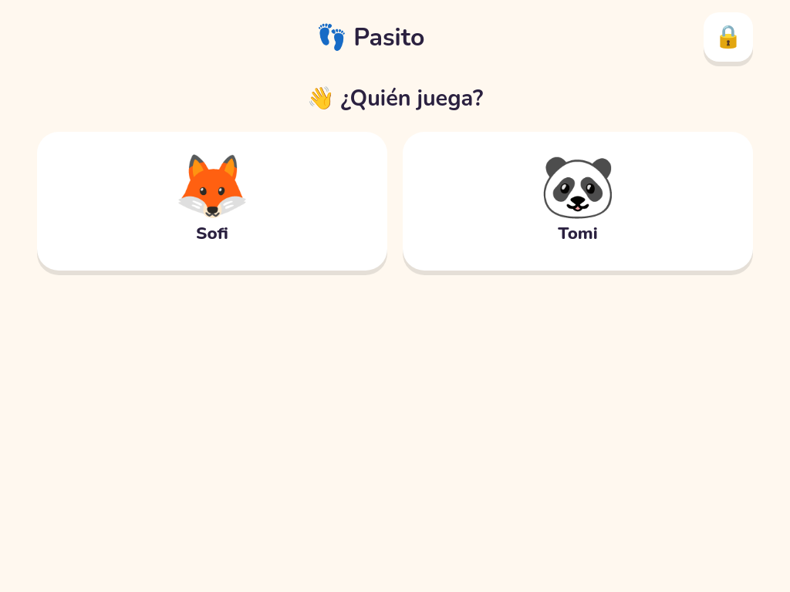
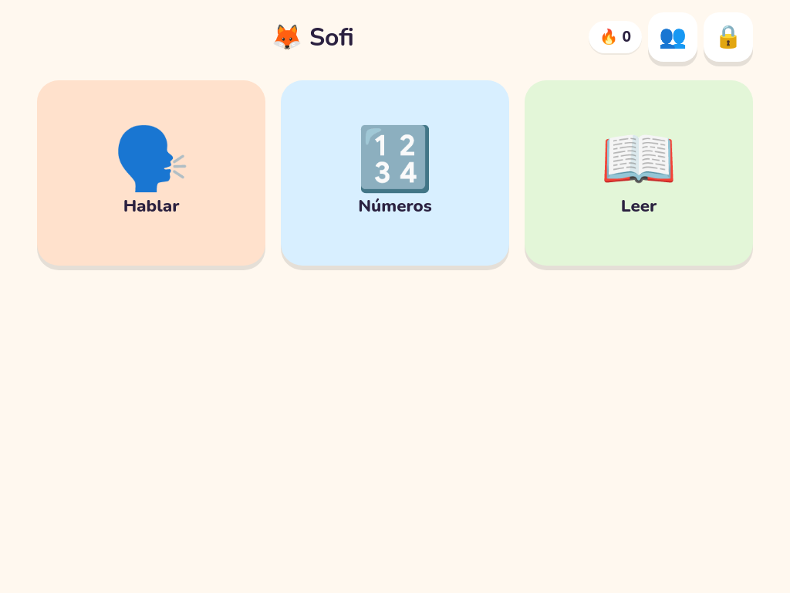
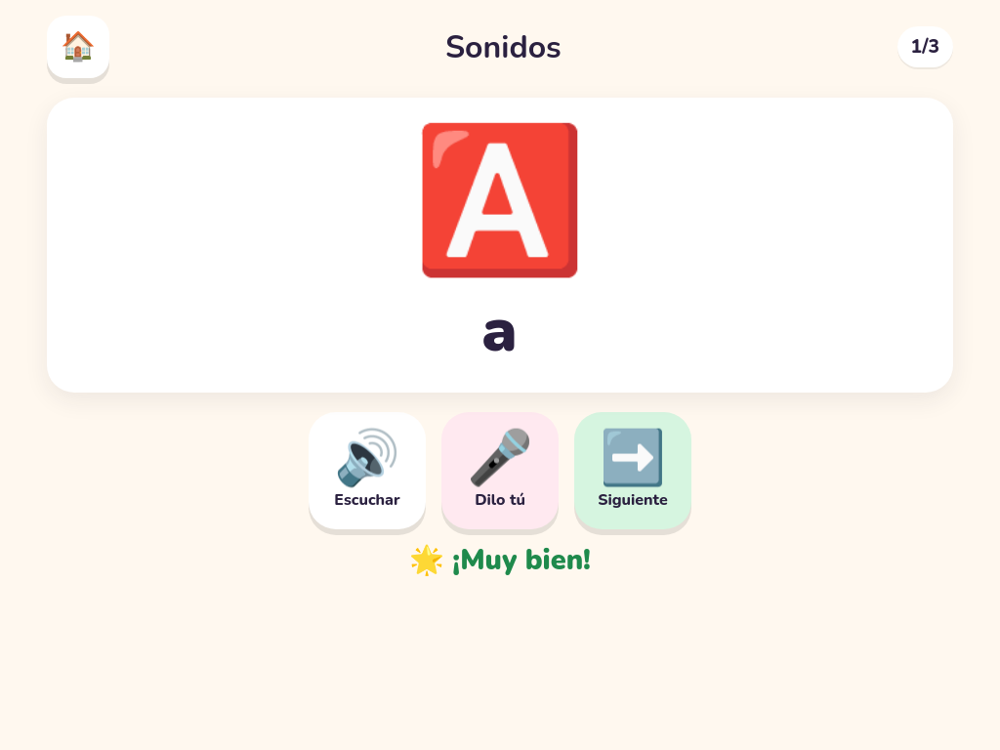
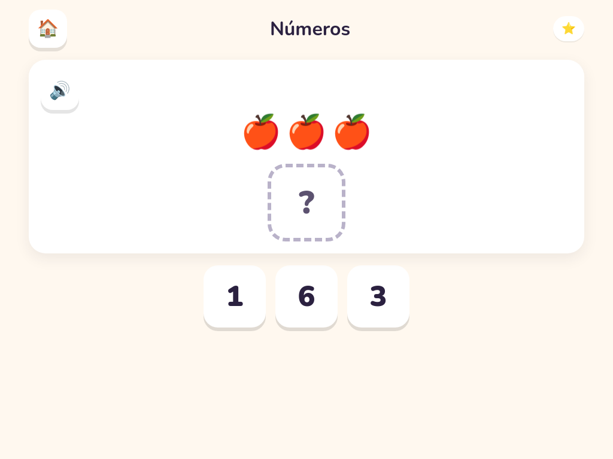
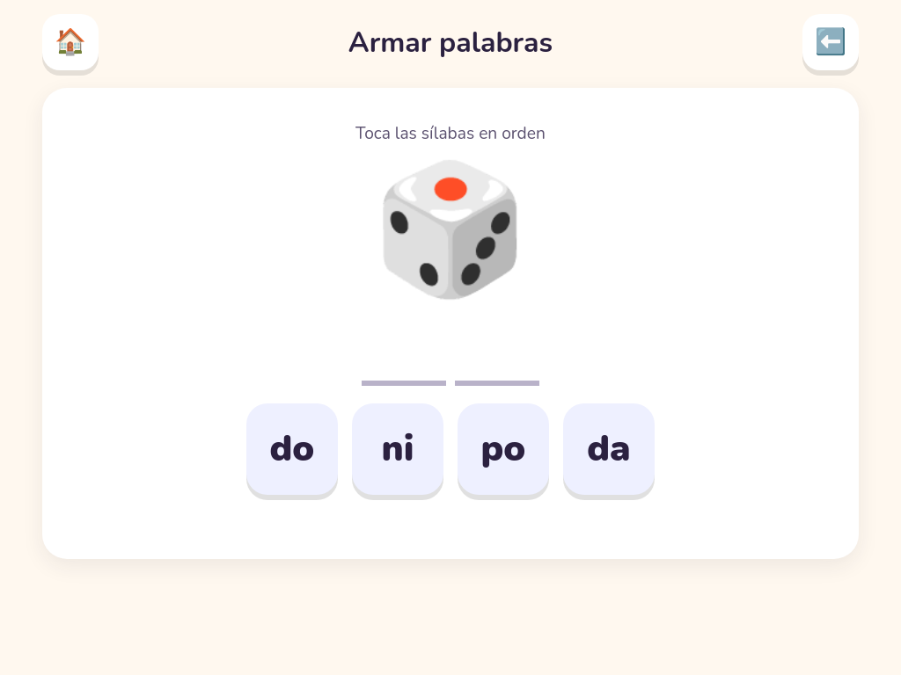
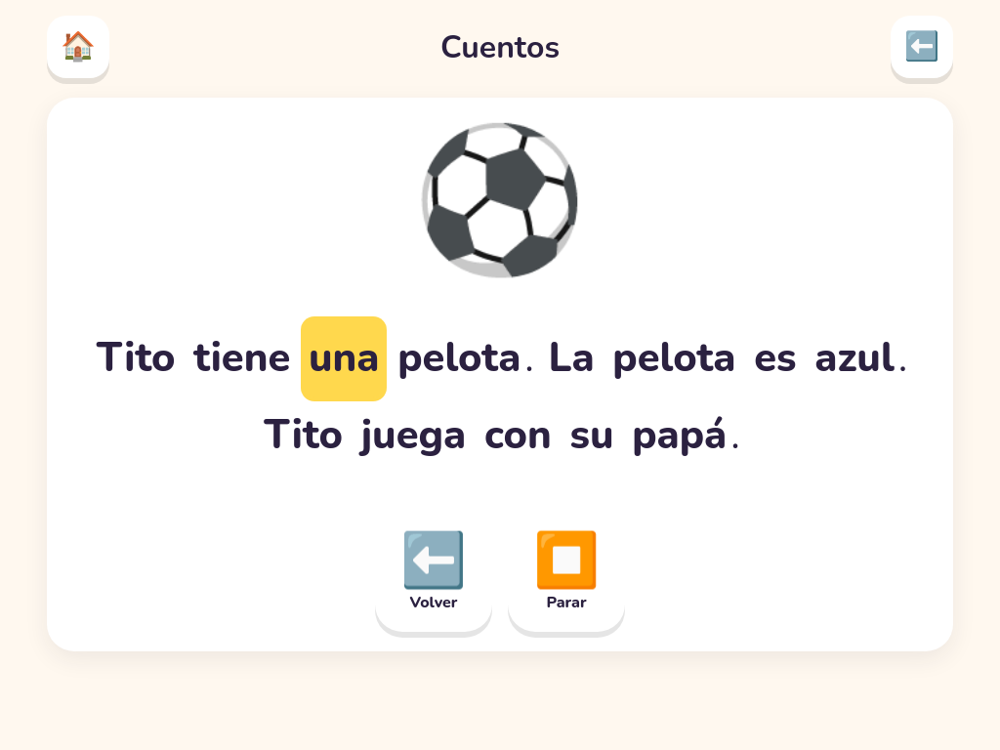
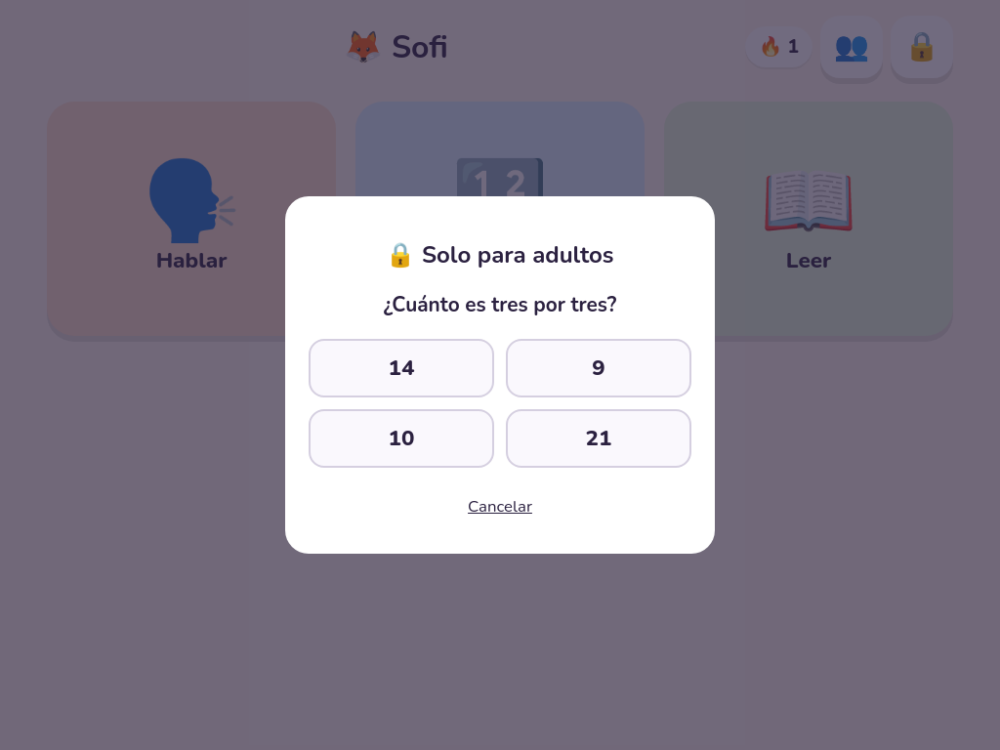
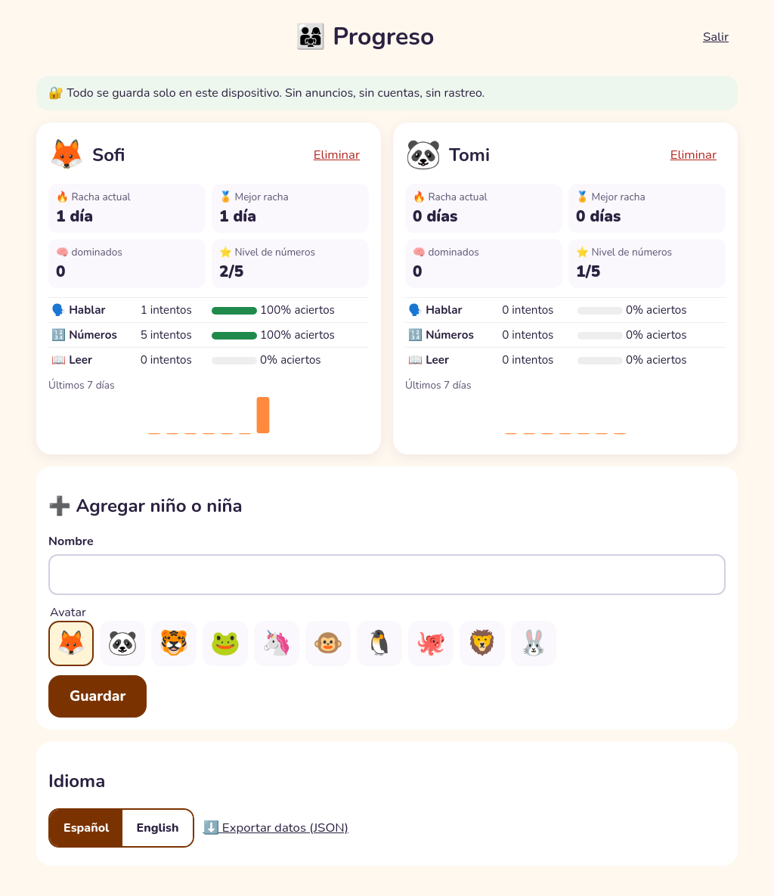
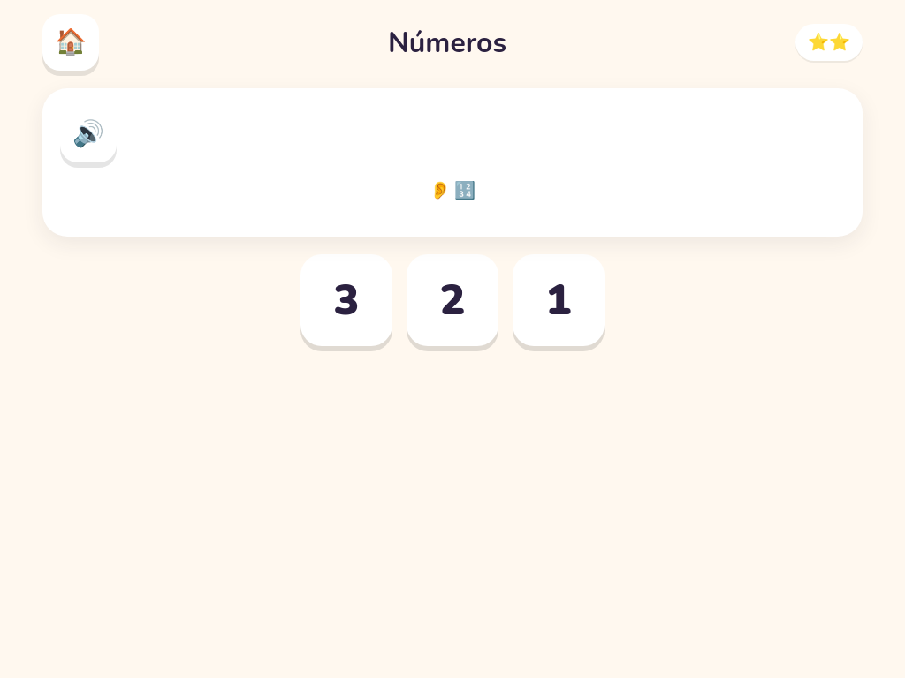
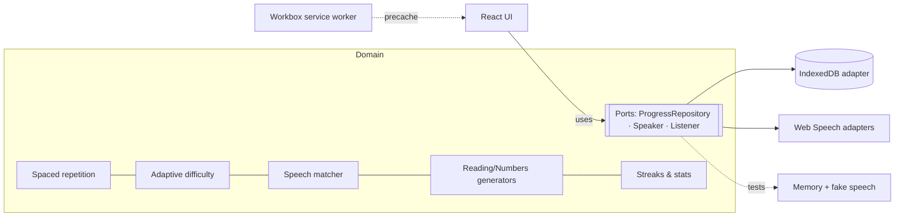

# 👣 Pasito: learn to speak, count and read through play

[](https://github.com/ipenas-cl/pasito/actions/workflows/ci.yml)
[](https://github.com/ipenas-cl/pasito/actions/workflows/pages.yml)


**Pasito** ("little step") is an offline-first learning app for children aged about 2 to 7. It has three modules: **speaking**, **numbers** and **reading** (Spanish phonics). The interface is in Spanish (Chile-neutral) with an English toggle. It installs as a PWA, works without a connection, keeps all data on the device, and has no ads, accounts, trackers or external links.

**Live demo:** https://ipenas-cl.github.io/pasito/

| Who's playing | Home | Speak |
|---|---|---|
|  |  |  |
| **Numbers (drag & drop)** | **Build words from syllables** | **Story read aloud with highlighting** |
|  |  |  |
| **Parent gate** | **Parent dashboard** | **Adaptive level 2** |
|  |  |  |

*Screenshots are generated by headless Playwright (`npm run screenshots`), so they always match the real app.*

## Features

### 🗣️ Speak
- Picture cards (emoji) read aloud with the **Web Speech API** (SpeechSynthesis), using a slow, slightly higher-pitched voice.
- **Speech recognition** listens to the child's attempt. A forgiving matcher (normalization, best of N alternatives, Levenshtein similarity, word-in-phrase) gives gentle feedback: 🌟 *¡Muy bien!*, 🙂 *¡Casi!* or 💪 *Escucha y prueba de nuevo*. A miss is never shown as an error.
- **Progressive curriculum:** sounds → syllables → words → short phrases. A stage unlocks when 60% of the previous one is mastered.
- If the browser has no speech recognition (Firefox, some iPads), it falls back to a 👍 "I said it" self-check, so the module still works.

### 🔢 Numbers
- Counting objects, recognizing spoken numerals, and addition and subtraction shown with objects (subtracted items are crossed out).
- **Drag and drop** built on Pointer Events, so it works with touch, mouse and pen. Tapping, or pressing Enter or Space, also answers, so it never blocks a toddler or a keyboard user.
- **Adaptive difficulty** across 5 levels (up to 3, up to 5, up to 10 with addition, subtraction, up to 20), persisted per child.

### 📖 Read
- **Letters and sounds:** a "listen and tap the letter" game over 20 Spanish phonics letters (including ñ), scheduled by spaced repetition.
- **Syllable families** (ma me mi mo mu, pa pe pi…) in the order Chilean schools usually teach them.
- **Build words from syllables** with distractor tiles. A wrong tile gives a gentle shake.
- **Short stories read aloud with word-by-word highlighting.** It uses SpeechSynthesis `boundary` events when the voice provides them, and an estimated timeline otherwise (many Android voices). Tapping any word reads it aloud.

### 👨‍👩‍👧 For parents
- **Multiple child profiles**, each with an avatar and its own progress.
- **Parent dashboard:** current and best streak, mastered items, numbers level, attempts and accuracy per module, and a 7-day activity chart.
- **Parent gate:** a multiplication written out in words ("¿Cuánto es siete por cuatro?"). Pre-readers can't pass it, and a wrong answer closes it. It protects profile management, settings and data export.
- **Export all data as JSON.** Nothing ever leaves the device unless you export it.

### Kid-safe and accessible by design
- **No reading needed to navigate:** every control is a big emoji button that reads its own label aloud when tapped. Touch targets are 88–120 px, well above WCAG's 44 px.
- No links, ads or third-party requests. A strict **Content-Security-Policy** (`default-src 'self'`) is injected into the production build.
- `prefers-reduced-motion` turns off the confetti and animations. Feedback is announced through `aria-live` regions. Focus is managed in the gate dialog.
- **axe-core** runs in e2e on every module (WCAG 2 A/AA), and **Lighthouse CI** asserts accessibility ≥ 0.95.

## Architecture

```
src/
├── domain/              Pure TypeScript, no React, no browser APIs (unit-tested)
│   ├── srs.ts           Leitner spaced repetition (5 boxes, child-sized intervals) + session picker
│   ├── adaptive.ts      Sliding-window difficulty controller
│   ├── speechMatch.ts   Forgiving Spanish speech matcher (normalize, Levenshtein, alternatives)
│   ├── numbers.ts       Seeded task generator per level
│   ├── reading.ts       Phonics, syllables, word builder, tokenizer + boundary→word mapping
│   ├── progress.ts      Activity log, streaks, per-module stats
│   ├── parentGate.ts    Gate challenge
│   └── ports.ts         ProgressRepository, Speaker, Listener interfaces
├── infra/               Adapters
│   ├── idbRepository.ts IndexedDB (idb) — offline persistence
│   ├── memoryRepository.ts  in-memory, for tests
│   └── webSpeech.ts     SpeechSynthesis / SpeechRecognition adapters
└── ui/                  React components; get adapters through context (dependency injection)
```

It follows a **ports and adapters** (hexagonal) layout. The domain is deterministic: randomness comes from a seeded PRNG passed in, and time from an injected clock. That makes the learning logic easy to test and the UI reproducible (`?seed=7`). React components never touch IndexedDB or speech APIs directly. They use the ports, which component tests replace with fakes.



## Design decisions

| Decision | Why |
|---|---|
| **No backend** | A sync API was considered and dropped. For a kids' app, keeping children's data on the device is the stronger privacy story: no accounts, no consent flows, no server to secure. The `ProgressRepository` port means a sync adapter can be added later without touching the domain or the UI. |
| **Leitner boxes instead of SM-2** | Toddlers' sessions are short and irregular, and SM-2's ease factors overfit noisy data. Five boxes with hour and day intervals are predictable and easy to explain to parents. |
| **Sliding window of 5 with a fast fallback** | The level rises at ≥ 80% correct and drops below 50%. Two misses at the start drop it immediately, so a child never stays frustrated for long. |
| **Generous speech matching** | Recognizers struggle with children's speech. Being strict would punish the child for the engine's errors, so near-misses count as "almost". |
| **Emoji as artwork** | They are license-safe, need no downloads and come in every OS style. The app ships no image assets except its own SVG icon. |
| **Pointer Events instead of HTML5 drag and drop** | HTML5 DnD doesn't work on touch screens, which is where kids actually use the app. |
| **Tap also answers** | Fine-motor skills at age 2–3 make dragging hard, so dragging is a bonus, never a requirement. |
| **Parent gate as a word-problem** | It follows the "adult verification" pattern recommended for kids' categories in app stores, without collecting any data. |
| **Seeded randomness** | It gives deterministic tests, reproducible bug reports and stable screenshots. |

## Getting started

```bash
npm install
npm run dev          # http://localhost:5173
npm test             # unit + component tests (Vitest, Testing Library, fake-indexeddb)
npx playwright install chromium
npm run test:e2e     # e2e on tablet + phone viewports, incl. axe and offline checks
npm run screenshots  # regenerate docs/screenshots
npm run build        # static build in dist/ (BASE=/pasito/ for GitHub Pages)
```

Speech recognition needs Chrome, Edge or Safari, and the mic is only available on `https://` or `localhost`.

## Testing

- **Domain unit tests:** spaced-repetition transitions and session picking, difficulty controller, speech matching, number generators (property-style checks over 1,000 generated tasks), syllable builder, tokenizer and boundary mapping, streaks, gate.
- **Adapter test:** IndexedDB repository, including cascading deletes, run against fake-indexeddb.
- **Component tests:** first-run onboarding behind the gate, a kid view with no links, gate rejection, speech feedback, locked stages, the self-check fallback, numbers answer and level-up, word building, story highlighting.
- **Playwright e2e** on tablet and phone: every main flow, a real pointer drag-and-drop, persistence across reloads, the parent dashboard and English toggle, **axe** on each module, and **offline reload through the service worker**.
- **CI** (GitHub Actions): lint, typecheck, unit and component tests, e2e, and Lighthouse CI with a11y and best-practices budgets. A separate workflow deploys to GitHub Pages.

## License

MIT © Ignacio Peña. All artwork is Unicode emoji, rendered by your system font, plus an original SVG icon.
